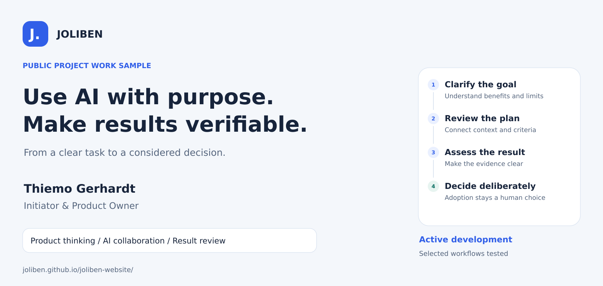

# JOLIBEN

### Use AI with purpose. Make results reviewable.

**An independent AI and product development project by Thiemo Gerhardt**  
**Initiator & Product Owner · Dresden region, Germany · active development**

[Explore the website](https://joliben.github.io/joliben-website/?lang=en) · [Experience the agents](https://joliben.github.io/joliben-website/agenten.html?lang=en) · [Project profile as a PDF](docs/JOLIBEN_Projektprofil_Thiemo_Gerhardt_EN.pdf) · [Deutsch](README.md)

## In one minute

JOLIBEN explores and develops how AI assistance can become a traceable workflow: A person describes a goal, reviews an AI proposal and decides on the next steps. Results should remain clearly connected to their assignment and the associated checks.

Selected planning, task-creation and interface workflows have already been implemented and tried in specific cases. A separate AI-assisted development path was taken through to a reviewed merge in one bounded case. The fully connected end-to-end workflow and controlled knowledge feedback remain in development.

**This repository contains the public presentation website and selected work samples. The application code and detailed internal architecture remain private.**

## Why I am working on this

An AI proposal alone does not complete a task. Practical use requires a clear goal, suitable context, clear responsibilities and a deliberate decision about the result. JOLIBEN focuses on precisely these transitions.

- **Clear assignments:** Record the goal, boundaries and acceptance criteria.
- **Deliberate decisions:** Review data, costs and scope before the relevant step.
- **Verifiable results:** Consider changes, tests and feedback together.
- **Traceable development:** Clearly distinguish implemented features, trials and future plans.

## The planned end-to-end process and progress to date

The graphic describes the intended relationship. The two paths tried so far do not yet form a fully connected, autonomous product workflow.

| Area | Documented status | Limit of the claim |
| --- | --- | --- |
| Planning and task creation | Implemented in selected user cases; original plan and assignment context visible; browser functionality confirmed | Creating a task is a separate decision and does not grant blanket authorisation to execute |
| Development and review | A bounded AI-assisted development cycle with focused tests, review and human integration is documented | The described cycle did not include a production rollout |
| Interface | Planning and task views are available; visual development continues | Full design parity and comprehensive UX sign-off remain outstanding |
| Public agent view | Explanatory interactive simulation on the website | No live AI calls and no connection to the private system |
| Brain & Learn | Controlled knowledge import, retrieval and result feedback are in progress | An effective, integrated learning capability has not yet been demonstrated |

[Development status in detail](docs/ENTWICKLUNGSSTAND.en.md) · [Process graphic as SVG](assets/portfolio/joliben-process.en.svg)

## Three concrete work samples

### Case study 01: Controlled development

**A bounded development assignment was followed from error reproduction through to reviewed integration.** Two new checks initially failed when checking for the desired behaviour. After a targeted correction, the relevant checks passed; subsequently, 16 selected regression tests passed. The change was adopted following review and human approval.

The figures describe that specific documented test scope. They represent neither the complete test suite nor independent product certification. This publication summarises the existing project report; it is not a new test run.

[Read the case study: controlled development](docs/FALLBEISPIEL_KONTROLLIERTE_ENTWICKLUNG.en.md) · [English PDF](docs/JOLIBEN_Fallstudie_01_Kontrollierte_Entwicklung_EN.pdf)

### Case study 02: From a request to a traceable task

An internal review request led through an AI-generated plan and a deliberate choice of project to an actual task. The original source remained traceable. The case also shows the next product requirement: The subsequent read-only investigation and its findings report were not yet represented in a complete end-to-end workflow. That substantive review was neither authorised nor performed in this case.

[Read the case study](docs/FALLSTUDIE_02_VOM_WUNSCH_ZUR_AUFGABE.en.md) · [Designed English PDF](docs/JOLIBEN_Fallstudie_02_Vom_Wunsch_zur_Aufgabe_EN.pdf)

### Case study 03: The broken Inbox — and the decision to take a closer look

In the documented case of 15 October 2026, the task overview returned HTTP 500. An initial repair candidate had passed 338 selected tests but was rejected because it would have misleadingly attributed global history conflicts to individual tasks. The later repair was limited to the read-only display; the existing strict start and authorisation checks remained unchanged.

The final report records 344 selected tests passed, 13 isolated HTTP checks and HTTP 200 both directly and through the fronting web gateway. The later browser confirmation is attributed to the user. The global history conflict remained unresolved and was still listed as an open historical issue in the status update of 20 October 2026. These are historical findings within the reported scope.

[Read the case study](docs/FALLSTUDIE_03_DIE_KAPUTTE_INBOX.en.md) · [Designed English PDF](docs/JOLIBEN_Fallstudie_03_Die_kaputte_Inbox_EN.pdf)

## My contribution as Initiator and Product Owner

I combine an IT background and entrepreneurial experience with practical AI product development. At JOLIBEN, I am responsible for the product idea, prioritise requirements, define working boundaries and acceptance criteria, and guide the review of results. Implementation and technical analysis are carried out in collaboration with AI tools.

| Competency | Visible in the project through |
| --- | --- |
| Product ownership | Product vision, prioritised development steps and substantive acceptance |
| AI project management | Bounded assignments, appropriate context selection and traceable handoffs |
| Quality focus | Reproducible failure cases, targeted tests and critical evaluation of what they establish |
| Responsible automation | Deliberate approvals for data, costs, implementation and adoption |
| Communication | Clear interface, documentation and public project work samples |

[More about my role](docs/THIEMO_GERHARDT.en.md) · [Selected work on the website](https://joliben.github.io/joliben-website/arbeiten.html?lang=en)

## Documents and downloads in German and English

| Resource | Deutsch | English |
| --- | --- | --- |
| Project profile | [Full text](docs/PROJEKTPROFIL.md) · [PDF](docs/JOLIBEN_Projektprofil_Thiemo_Gerhardt.pdf) | [Full text](docs/PROJEKTPROFIL.en.md) · [PDF](docs/JOLIBEN_Projektprofil_Thiemo_Gerhardt_EN.pdf) |
| Case study 01: Controlled development | [Full text](docs/FALLBEISPIEL_KONTROLLIERTE_ENTWICKLUNG.md) · [PDF](docs/JOLIBEN_Fallstudie_01_Kontrollierte_Entwicklung.pdf) | [Full text](docs/FALLBEISPIEL_KONTROLLIERTE_ENTWICKLUNG.en.md) · [PDF](docs/JOLIBEN_Fallstudie_01_Kontrollierte_Entwicklung_EN.pdf) |
| Case study 02: From a request to a traceable task | [Full text](docs/FALLSTUDIE_02_VOM_WUNSCH_ZUR_AUFGABE.md) · [PDF](docs/JOLIBEN_Fallstudie_02_Vom_Wunsch_zur_Aufgabe.pdf) | [Full text](docs/FALLSTUDIE_02_VOM_WUNSCH_ZUR_AUFGABE.en.md) · [PDF](docs/JOLIBEN_Fallstudie_02_Vom_Wunsch_zur_Aufgabe_EN.pdf) |
| Case study 03: The broken Inbox | [Full text](docs/FALLSTUDIE_03_DIE_KAPUTTE_INBOX.md) · [PDF](docs/JOLIBEN_Fallstudie_03_Die_kaputte_Inbox.pdf) | [Full text](docs/FALLSTUDIE_03_DIE_KAPUTTE_INBOX.en.md) · [PDF](docs/JOLIBEN_Fallstudie_03_Die_kaputte_Inbox_EN.pdf) |
| Role and background | [Read](docs/THIEMO_GERHARDT.md) | [Read](docs/THIEMO_GERHARDT.en.md) |
| Development status | [Read](docs/ENTWICKLUNGSSTAND.md) | [Read](docs/ENTWICKLUNGSSTAND.en.md) |

All four portfolio graphics are available in [assets/portfolio](assets/portfolio) as German and English PNG and SVG files. English filenames contain `.en`. The graphics above use the English editions. Standalone preview instructions: [Deutsch](VORSCHAU.md) · [English](VORSCHAU.en.md).

## Explore and contact

- [Website and project overview](https://joliben.github.io/joliben-website/?lang=en)
- [Interactive agent simulation](https://joliben.github.io/joliben-website/agenten.html?lang=en)
- [Selected project cases](https://joliben.github.io/joliben-website/arbeiten.html?lang=en)
- [Public roadmap](https://joliben.github.io/joliben-website/?lang=en#fahrplan)
- [Two-page project profile for job applications](docs/JOLIBEN_Projektprofil_Thiemo_Gerhardt_EN.pdf)
- [Contact: thiemo.gerhardt@icloud.com](mailto:thiemo.gerhardt@icloud.com)

The presentation website uses static HTML, CSS and JavaScript. The graphics and documents added here do not establish a connection to the private JOLIBEN system. Information about website operations is available in the [Legal notice](https://joliben.github.io/joliben-website/impressum.html?lang=en) and [Privacy policy](https://joliben.github.io/joliben-website/datenschutz.html?lang=en).

**Editorial version: 22 October 2026 · Bilingual edition: 23 October 2026.** Technical statements refer to documented project states from 15–20 October 2026. The core remains private; this presentation package does not release the application code as open source.
