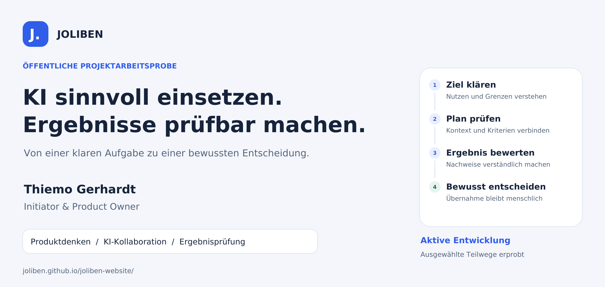

# JOLIBEN

### KI sinnvoll einsetzen. Ergebnisse prüfbar machen.

**Ein eigenständiges KI- und Produktentwicklungsprojekt von Thiemo Gerhardt**  
**Initiator & Product Owner · Raum Dresden · aktive Entwicklung**

[Website entdecken](https://joliben.github.io/joliben-website/) · [Agenten erleben](https://joliben.github.io/joliben-website/agenten.html) · [Projektprofil als PDF](docs/JOLIBEN_Projektprofil_Thiemo_Gerhardt.pdf) · [English](README.en.md)

## In einer Minute

JOLIBEN untersucht und entwickelt, wie aus KI-Unterstützung ein nachvollziehbarer Arbeitsablauf wird: Ein Mensch beschreibt sein Ziel, prüft einen KI-Vorschlag und entscheidet über die nächsten Schritte. Ergebnisse sollen mit ihrem Auftrag und den zugehörigen Prüfungen verständlich verbunden bleiben.

Einzelne Planungs-, Aufgaben- und UI-Abläufe sind bereits umgesetzt und in ausgewählten Fällen erprobt. Ein separater KI-unterstützter Entwicklungsweg wurde an einem begrenzten Fall bis zum geprüften Merge durchlaufen. Die durchgängig verbundene Gesamtstrecke und ein kontrollierter Wissensrücklauf werden weiterentwickelt.

**Dieses Repository enthält die öffentliche Präsentationswebsite und ausgewählte Arbeitsproben. Der Anwendungscode und die detaillierte interne Architektur bleiben privat.**

## Warum ich daran arbeite

Ein KI-Vorschlag allein erledigt noch keine Aufgabe. Für den praktischen Einsatz braucht es ein verständliches Ziel, passenden Kontext, klare Zuständigkeiten und eine bewusste Entscheidung über das Ergebnis. Genau an diesen Übergängen setzt JOLIBEN an.

- **Verständliche Aufträge:** Ziel, Grenzen und Abnahmekriterien festhalten.
- **Bewusste Entscheidungen:** Daten, Kosten und Arbeitsumfang vor dem jeweiligen Schritt prüfen.
- **Überprüfbare Ergebnisse:** Änderungen, Tests und Rückmeldungen zusammen betrachten.
- **Nachvollziehbare Entwicklung:** Umgesetzte Funktionen, Erprobung und Zukunftspläne sichtbar auseinanderhalten.

## Der geplante Gesamtprozess und der erreichte Stand

Die Grafik beschreibt den angestrebten Zusammenhang. Die beiden erprobten Teilwege bilden noch keinen vollständig verbundenen, autonomen Produktablauf.

| Bereich | Dokumentierter Stand | Aussagegrenze |
| --- | --- | --- |
| Planung und Aufgabenanlage | In ausgewählten Nutzerfällen umgesetzt; Originalplan und Auftragsbezug sichtbar; Browserfunktion bestätigt | Die Anlage einer Aufgabe ist eine eigene Entscheidung und erteilt keine pauschale Ausführungsfreigabe |
| Entwicklung und Review | Begrenzter KI-unterstützter Entwicklungszyklus mit fokussierten Tests, Review und menschlicher Integration dokumentiert | Der beschriebene Zyklus umfasste keinen Produktivrollout |
| Oberfläche | Planungs- und Aufgabenansichten vorhanden; visuelle Weiterentwicklung läuft | Vollständige Designparität und umfassende UX-Abnahme stehen aus |
| Öffentliche Agentenansicht | Erklärende interaktive Simulation auf der Website | Ohne echte KI-Aufrufe und ohne Verbindung zum privaten System |
| Brain & Learn | Kontrollierter Wissensimport, Abruf und Ergebnisrücklauf in Arbeit | Eine wirksame, integrierte Lernfunktion ist noch nicht nachgewiesen |

[Entwicklungsstand im Detail](docs/ENTWICKLUNGSSTAND.md) · [Prozessgrafik als SVG](assets/portfolio/joliben-process.svg)

## Eine konkrete Arbeitsprobe

**Ein begrenzter Entwicklungsauftrag wurde von der Fehlerreproduktion bis zur geprüften Integration begleitet.** Zwei neue Prüfungen zeigten das gewünschte Verhalten zunächst als Fehler. Nach der gezielten Korrektur waren die zugehörigen Prüfungen erfolgreich; anschließend bestanden 16 ausgewählte Regressionstests. Die Änderung wurde nach Review und menschlicher Freigabe übernommen.

Die Zahlen beschreiben genau diesen dokumentierten Prüfumfang. Sie stehen weder für die vollständige Testsuite noch für eine unabhängige Produktzertifizierung. Die Veröffentlichung ist eine Zusammenfassung des bestehenden Projektberichts, kein neuer Testlauf.

[Zur Fallstudie: kontrollierte Entwicklung](docs/FALLBEISPIEL_KONTROLLIERTE_ENTWICKLUNG.md)

## Mein Beitrag als Initiator und Product Owner

Ich verbinde IT-Hintergrund und unternehmerische Erfahrung mit praktischer KI-Produktentwicklung. Bei JOLIBEN verantworte ich die Produktidee, priorisiere Anforderungen, definiere Arbeitsgrenzen und Abnahmekriterien und begleite die Prüfung der Ergebnisse. Implementierung und technische Analysen entstehen in Zusammenarbeit mit KI-Werkzeugen.

| Kompetenz | Im Projekt sichtbar an |
| --- | --- |
| Product Ownership | Zielbild, priorisierte Entwicklungsschritte und fachliche Abnahme |
| KI-Projektmanagement | Begrenzte Aufträge, passende Kontextauswahl und nachvollziehbare Übergaben |
| Qualitätsorientierung | Reproduzierbare Fehlerfälle, gezielte Tests und kritische Bewertung ihrer Aussagekraft |
| Verantwortbare Automatisierung | Bewusste Freigaben für Daten, Kosten, Umsetzung und Übernahme |
| Kommunikation | Verständliche Oberfläche, Dokumentation und öffentliche Projektarbeitsproben |

[Mehr zu meiner Rolle](docs/THIEMO_GERHARDT.md) · [Ausgewählte Arbeiten auf der Website](https://joliben.github.io/joliben-website/arbeiten.html)

## Erkunden und Kontakt

- [Website und Projektüberblick](https://joliben.github.io/joliben-website/)
- [Interaktive Agentensimulation](https://joliben.github.io/joliben-website/agenten.html)
- [Ausgewählte Projektfälle](https://joliben.github.io/joliben-website/arbeiten.html)
- [Öffentlicher Fahrplan](https://joliben.github.io/joliben-website/#fahrplan)
- [Zweiseitiges Projektprofil für Bewerbungen](docs/JOLIBEN_Projektprofil_Thiemo_Gerhardt.pdf)
- [Kontakt: thiemo.gerhardt@icloud.com](mailto:thiemo.gerhardt@icloud.com)

Die Präsentationswebsite verwendet statisches HTML, CSS und JavaScript. Die hier ergänzten Grafiken und Dokumente stellen keine Verbindung zum privaten JOLIBEN-System her. Informationen zum Websitebetrieb stehen in [Impressum](https://joliben.github.io/joliben-website/impressum.html) und [Datenschutz](https://joliben.github.io/joliben-website/datenschutz.html).

**Redaktioneller Stand: 22.10.2026.** Fachliche Aussagen beziehen sich auf dokumentierte Projektstände vom 15. bis 20.10.2026. Der Core bleibt privat; dieses Präsentationspaket erteilt keine Open-Source-Freigabe des Anwendungscodes.
